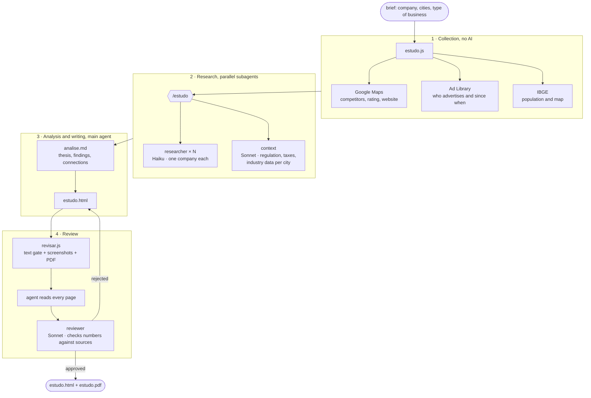

# market-study-agent

[Português](README.md) | **English**

This project produces a **market and competitor study for local businesses**
using only public data. It is an agent architecture built on top of
[Claude Code](https://claude.com/claude-code).

The user provides the company, the cities where it sells, and the type of
business. The output is a 6 to 10 page document. It covers the market thesis,
findings with numbers and sources, who advertises and since when, the order in
which to enter each city, message ideas for ads, and the open questions only the
client can answer.

> **This project runs inside Claude Code.** It ships no API key and never calls
> a model on its own. The Claude Code agent, on your own subscription, is what
> orchestrates the research, writes the analysis and reviews the result.
> Without Claude Code, only the data collection is left: tables and charts, no
> analysis.

## Why an agent, and not a script

Data is the cheap part. Scraping Google Maps, counting ads and pulling
population figures from IBGE (Brazil's statistics bureau) is deterministic, so
it's a script. What a client pays to read is **the connection nobody made**.
For example, finding out that the smallest city in the region concentrates an
audience the larger ones don't have changes the offer and the expansion order of
the plan. No script finds that, because the question wasn't written anywhere.

That's why the architecture separates the two and puts each job at the cheapest
level that solves it:



| Layer | Who does it | Why |
|---|---|---|
| Collection | Node and Python scripts | It's deterministic. Large output stays in files and never enters the model's context. |
| Per-company research | `pesquisador` subagent (Haiku), one per company, in parallel | It's grunt work. Only a JSON with sources goes back to the main agent. |
| Industry context | `contexto` subagent (Sonnet) | It needs judgment about sources: official over blogs. |
| Analysis and writing | main agent | It's judgment, the part that sells. It is not delegated. |
| Review | `revisar.js` + `revisor` subagent | The mechanical gate catches gaps; the reviewer catches numbers without a source. |

Decisions and trade-offs are in [`docs/arquitetura.md`](docs/arquitetura.md)
(in Portuguese).

## Requirements

- [Claude Code](https://claude.com/claude-code)
- Node 20 or later, Python 3.10 or later
- Google Chrome, which the collection drives through `playwright-core`
- Optional: [opencli](https://github.com/jackwener/opencli), to read public
  Instagram profiles through the browser. Without it, the agent falls back to
  web search and the Instagram research is less complete.

```bash
git clone https://github.com/pedroschell/market-study-agent.git
cd market-study-agent
cd coleta && npm install && cd ..
cp .claude/settings.sugerido.json .claude/settings.json   # permissions and read-only hook
git config core.hooksPath .githooks                      # verificar.js before every commit
```

## Usage

Open Claude Code in the project folder and run:

```
/estudo Example Clinic, dental clinic in City ST and Neighboring City ST,
website example.com.br, @exampleclinic, appointment at R$ 150
```

The agent follows `.claude/commands/estudo.md`. Collection takes 5 to 15
minutes, and research plus analysis takes 10 to 20. At the end, it replies with
the thesis, the findings and the path to the HTML and PDF.

Each study lives in its own folder, which is **never versioned**:

```
estudos/<client>/
  briefing.md     what the user provided
  dados/          raw collection (Maps, Ad Library)
  pesquisa/       one JSON per company + contexto.json, every data point with a URL
  analise.md      the analysis before it becomes a document
  estudo.html     the document
  estudo.pdf      the same document, ready to send
  revisao/        screenshots the agent reads before delivering
```

### Without Claude Code

The collection works on its own and produces the skeleton with map, tables and
charts:

```bash
node estudo.js            # asks for company, cities and type of business
node revisar.js <client>  # will fail: the whole analysis is missing
```

## Security

The project was built to be public without exposing the people who use it:

| Risk | Protection |
|---|---|
| Client data in the repository | `estudos/` and `praca.json` are in `.gitignore`. `verificar.js` reads the names and cities of each local study and searches for those terms in versioned files. |
| Key or token in the code | The project doesn't need any. `verificar.js` looks for Anthropic, OpenAI, GitHub, Meta, Google, AWS and Slack key patterns, plus Bearer tokens and OAuth secrets. |
| Study screenshot committed by mistake | Images and PDFs are only allowed in `template/assets/` and `docs/`. |
| Path containing a username | `/Users/<name>/` and `/home/<name>/` fail the commit. |
| Agent writing on social media | The `.claude/hooks/so-leitura.js` hook blocks any opencli subcommand that writes (follow, like, comment, post…). |
| Agent committing on its own | The same hook and the `deny` list block `git commit` and `git push`. |
| Browser session | opencli uses the user's own browser. No cookie or session passes through the project. |

`node verificar.js` runs on its own and also in the pre-commit hook.

## Structure

| Path | What it is |
|---|---|
| `CLAUDE.md` | The agent's contract: layers, rules and commands |
| `.claude/commands/estudo.md` | The `/estudo` orchestrator |
| `.claude/agents/` | `pesquisador`, `contexto` and `revisor` |
| `.claude/hooks/so-leitura.js` | Blocks writes to social media and git |
| `metodo/ANALISE.md` | How to think about and write the analysis: the eight questions and the yardstick |
| `estudo.js` | Collection: registers, scrapes Maps, measures ads and assembles |
| `coleta/` | Maps, Ad Library, public Instagram |
| `montar.js` | IBGE, map and tables inside the document |
| `revisar.js` | Quality gate, screenshots and PDF |
| `verificar.js` | Scan for secrets and client data |
| `mapa/` | SVG map per municipality, from IBGE's official boundaries |
| `template/` | Template document and visual theme, no charting library |
| `CATALOGO.md` | The product's 18 analyses and what is left out |

## Limits

- **A competitor's spend in R$ is not public.** The study shows who advertises,
  how much and since when. It never shows how much they spend.
- **Hotels and guesthouses:** on these listings Maps shows a price instead of the
  website, so the website tracking goes unmeasured.
- **Instagram:** Instagram's rate limit sometimes blocks the reading. The agent
  falls back to web search and records the gap.
- **The reviewer reduces errors, it doesn't eliminate them.** Read the PDF before
  sending it.

## License

MIT.
