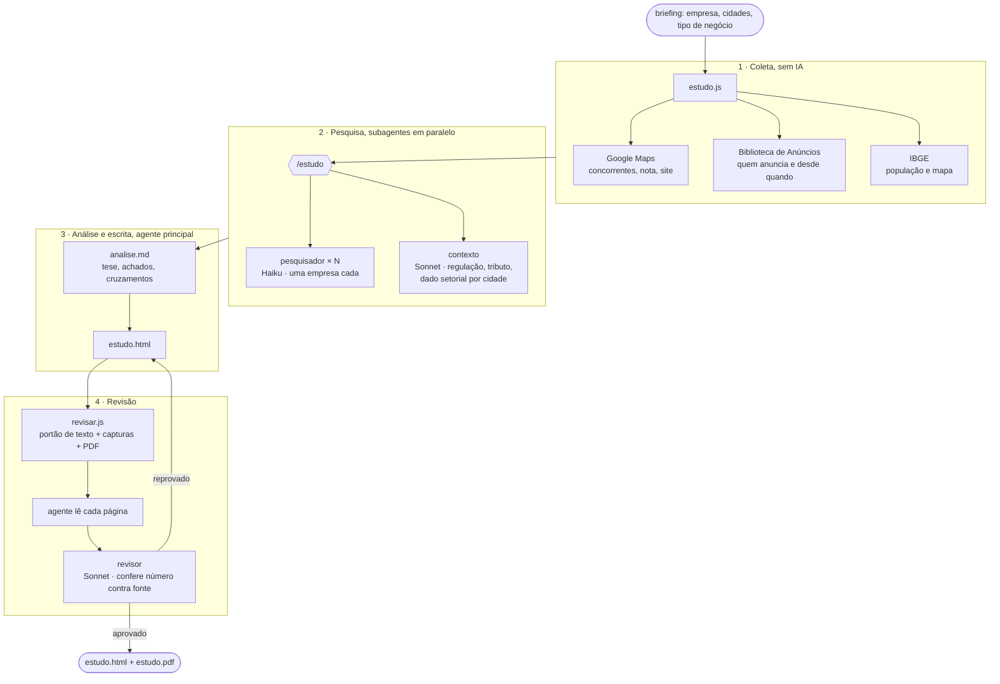

# estudo-mercado

Este projeto gera um **estudo de mercado e concorrência para negócios locais**
usando só dados públicos. É uma arquitetura de agente construída sobre o
[Claude Code](https://claude.com/claude-code).

O usuário informa a empresa, as cidades onde ela vende e o tipo de negócio. A
saída é um documento de 6 a 10 páginas. Ele traz a tese do mercado, os achados
com número e fonte, quem anuncia e desde quando, a ordem de entrada na praça,
ideias de mensagem para anúncios e as pendências que só o cliente pode
responder.

> **Este projeto roda dentro do Claude Code.** Ele não traz chave de API nem
> chama modelo por conta própria. Quem orquestra a pesquisa, escreve a análise
> e revisa o resultado é o agente do Claude Code, com a sua própria assinatura.
> Sem o Claude Code, sobra só a coleta: tabelas e gráficos, sem análise.

## Por que um agente, e não um script

O dado é a parte barata. Raspar o Google Maps, contar anúncios e puxar a
população do IBGE é determinístico, então é script. O que um cliente paga para
ler é o **cruzamento que ninguém fez**. Por exemplo, descobrir que a cidade pequena
da praça concentra um público que as maiores não têm muda a oferta e a ordem de
expansão do plano. Nenhum script encontra isso, porque a pergunta não estava
escrita em lugar nenhum.

Por isso a arquitetura separa as duas coisas e põe cada trabalho no nível mais
barato que resolve:



| Camada | Quem faz | Por quê |
|---|---|---|
| Coleta | scripts Node e Python | É determinística. A saída grande fica em arquivo e não entra no contexto do modelo. |
| Pesquisa por empresa | subagente `pesquisador` (Haiku), um por empresa, em paralelo | É volume braçal. Só um JSON com fonte volta ao agente principal. |
| Contexto do setor | subagente `contexto` (Sonnet) | Exige critério de fonte: oficial acima de blog. |
| Análise e escrita | agente principal | É julgamento, a parte que se vende. Não é delegada. |
| Revisão | `revisar.js` + subagente `revisor` | O portão mecânico pega a lacuna; o revisor pega número sem fonte. |

As decisões e os trade-offs estão em [`docs/arquitetura.md`](docs/arquitetura.md).

## Requisitos

- [Claude Code](https://claude.com/claude-code)
- Node 20 ou superior, Python 3.10 ou superior
- Google Chrome, que a coleta dirige via `playwright-core`
- Opcional: [opencli](https://github.com/jackwener/opencli), para ler perfis
  públicos do Instagram pelo navegador. Sem ele, o agente usa busca na web e a
  pesquisa de Instagram fica menos completa.

```bash
git clone https://github.com/pedroschell/estudo-mercado.git
cd estudo-mercado
cd coleta && npm install && cd ..
cp .claude/settings.sugerido.json .claude/settings.json   # permissões e hook de só-leitura
git config core.hooksPath .githooks                      # verificar.js antes de cada commit
```

## Uso

Abra o Claude Code na pasta do projeto e rode:

```
/estudo Clínica Exemplo, clínica odontológica em Cidade UF e Cidade Vizinha UF,
site exemplo.com.br, @clinicaexemplo, consulta a R$ 150
```

O agente segue `.claude/commands/estudo.md`. A coleta leva de 5 a 15 minutos e
a pesquisa com análise, de 10 a 20. No fim, ele responde com a tese, os achados
e o caminho do HTML e do PDF.

Cada estudo fica na própria pasta, que **nunca é versionada**:

```
estudos/<cliente>/
  briefing.md     o que o usuário informou
  dados/          coleta bruta (Maps, Biblioteca de Anúncios)
  pesquisa/       um JSON por empresa + contexto.json, cada dado com URL
  analise.md      a análise antes de virar documento
  estudo.html     o documento
  estudo.pdf      o mesmo documento, para enviar
  revisao/        capturas que o agente lê antes de entregar
```

### Sem o Claude Code

A coleta funciona sozinha e produz o esqueleto com mapa, tabelas e gráficos:

```bash
node estudo.js            # pergunta empresa, cidades e tipo de negócio
node revisar.js <cliente> # vai reprovar: falta toda a análise
```

## Segurança

O projeto foi feito para ser público sem expor quem o usa:

| Risco | Proteção |
|---|---|
| Dado de cliente no repositório | `estudos/` e `praca.json` estão no `.gitignore`. O `verificar.js` lê os nomes e as cidades de cada estudo local e procura esses termos nos arquivos versionados. |
| Chave ou token no código | O projeto não precisa de nenhum. O `verificar.js` procura padrões de chave Anthropic, OpenAI, GitHub, Meta, Google, AWS e Slack, além de token Bearer e segredo OAuth. |
| Captura de estudo commitada por engano | Imagem e PDF só passam em `template/assets/` e `docs/`. |
| Caminho com nome de usuário | `/Users/<nome>/` e `/home/<nome>/` reprovam o commit. |
| Agente escrevendo em rede social | O hook `.claude/hooks/so-leitura.js` bloqueia qualquer subcomando do opencli que escreva (seguir, curtir, comentar, postar…). |
| Agente commitando por conta própria | O mesmo hook e a lista `deny` bloqueiam `git commit` e `git push`. |
| Sessão do navegador | O opencli usa o navegador do próprio usuário. Nenhum cookie ou sessão passa pelo projeto. |

`node verificar.js` roda sozinho e também no gancho de pre-commit.

## Estrutura

| Caminho | O que é |
|---|---|
| `CLAUDE.md` | O contrato do agente: camadas, regras e comandos |
| `.claude/commands/estudo.md` | O orquestrador `/estudo` |
| `.claude/agents/` | `pesquisador`, `contexto` e `revisor` |
| `.claude/hooks/so-leitura.js` | Bloqueio de escrita em rede social e git |
| `metodo/ANALISE.md` | Como pensar e escrever a análise: as oito perguntas e a régua |
| `estudo.js` | Coleta: cadastra, raspa o Maps, mede anúncios e monta |
| `coleta/` | Maps, Biblioteca de Anúncios, Instagram público |
| `montar.js` | IBGE, mapa e tabelas dentro do documento |
| `revisar.js` | Portão de qualidade, capturas e PDF |
| `verificar.js` | Varredura de segredo e de dado de cliente |
| `mapa/` | Mapa SVG por município, a partir da malha oficial do IBGE |
| `template/` | Documento-modelo e tema visual, sem biblioteca de gráfico |
| `CATALOGO.md` | As 18 análises do produto e o que fica fora |

## Limites

- **Investimento em R$ do concorrente não é público.** O estudo mostra quem
  anuncia, quanto e desde quando. Nunca mostra quanto gasta.
- **Hotel e pousada:** nesses cartões o Maps mostra preço no lugar do site, e o
  rastreamento do site fica sem medir.
- **Instagram:** o limite de consultas do Instagram às vezes barra a leitura. O
  agente cai para busca na web e registra a lacuna.
- **O revisor reduz erro, não o elimina.** Leia o PDF antes de enviar.

## Licença

MIT.
